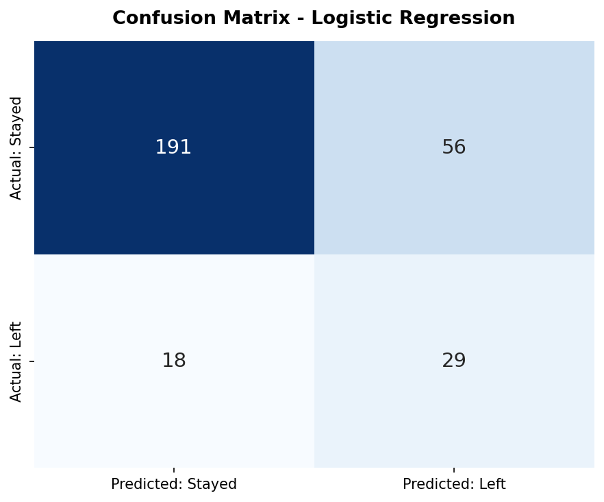
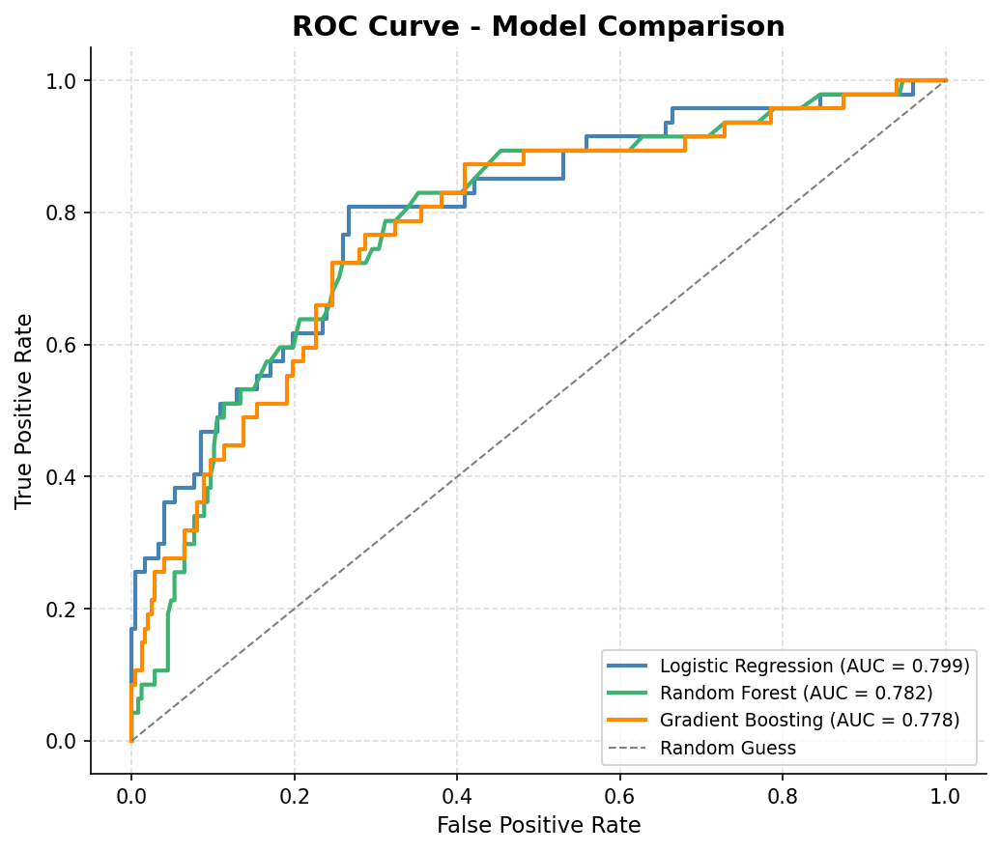
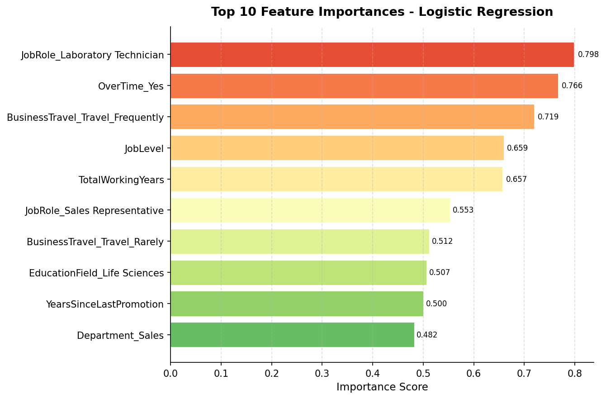
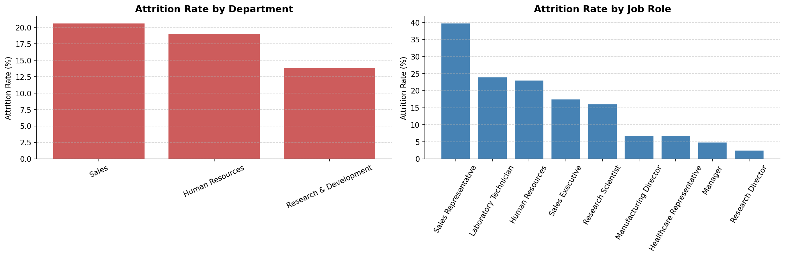
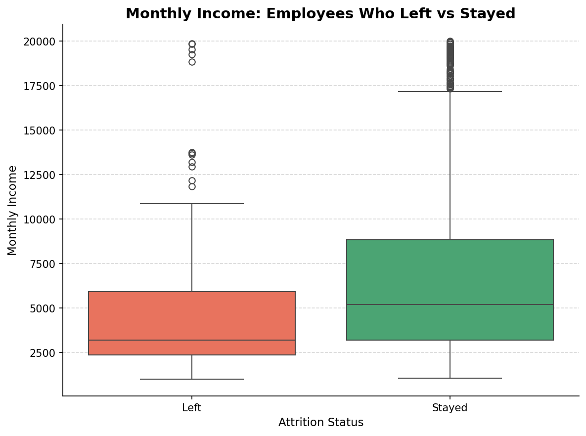

# 👥 Employee Attrition Prediction

An end-to-end machine learning project that predicts which employees are likely to leave a company, and explains **why**, so HR can act before a resignation happens. Built as **Week 2** of my AI & Data Science internship at **XYlofy AI**.

  

---

## 📌 Project Overview

Losing employees is expensive, and most companies only find out *after* someone resigns. This project treats attrition as a **classification problem**: given an employee's profile (role, overtime, travel, income, tenure, and more), predict whether they will leave (`Yes`) or stay (`No`).

The project covers the full workflow: data exploration, cleaning, EDA, training three models, evaluation on an imbalanced dataset, visualization, and a plain-language HR summary with recommendations.

## 📊 Dataset

| Item | Detail |
|---|---|
| **File** | `HR_Attrition.csv` (IBM HR Analytics dataset) |
| **Size** | 1,470 employees, 35 columns |
| **Target** | `Attrition` (Yes / No) |
| **Class balance** | 1,233 stayed (83.9%) vs 237 left (16.1%), a clearly **imbalanced** dataset |
| **Features** | Department, JobRole, OverTime, BusinessTravel, MonthlyIncome, JobLevel, TotalWorkingYears, YearsAtCompany, WorkLifeBalance, MaritalStatus, and more |

## 🛠️ Tech Stack

- **Language:** Python
- **Data:** pandas, NumPy
- **Visualization:** matplotlib, seaborn
- **Machine learning:** scikit-learn (Logistic Regression, Random Forest, Gradient Boosting, StandardScaler, metrics)

## 🔄 Workflow

1. **Data Loading & Exploration:** shape, data types, attrition distribution, numeric vs categorical columns
2. **Data Cleaning & Preprocessing:**
   - Checked for missing values (none found)
   - Dropped irrelevant or constant columns: `EmployeeNumber`, `Over18`, `StandardHours`, `EmployeeCount`
   - Converted target `Attrition` from Yes/No to 1/0
   - One-Hot Encoded 7 categorical columns (`drop_first=True`), giving 44 features
   - Scaled all features with `StandardScaler`
3. **Exploratory Data Analysis:** attrition by department, job role, work-life balance, tenure band, and monthly income
4. **Model Building:** stratified 80/20 train-test split (`random_state=42`), trained three models with class balancing to handle the imbalance
5. **Model Evaluation:** compared Precision, Recall, F1-Score, and ROC-AUC; ran a confusion matrix and an overfitting check
6. **Visualization:** 5 charts saved to `charts/`
7. **HR Insights:** top risk factors, priority team, and two actionable recommendations

> **Why not just accuracy?** With 84% of employees staying, a model that predicts "stays" for everyone would be ~84% accurate and completely useless. So this project focuses on **Precision, Recall, F1, and ROC-AUC**, and uses class balancing (`class_weight='balanced'` and sample weights for Gradient Boosting).

## 📈 Results

| Model | Precision | Recall | F1-Score | ROC-AUC |
|---|---|---|---|---|
| **Logistic Regression** 🏆 | 0.3412 | 0.6170 | 0.4394 | **0.7986** |
| Random Forest | 0.5714 | 0.0851 | 0.1481 | 0.7819 |
| Gradient Boosting | 0.4255 | 0.4255 | 0.4255 | 0.7778 |

**Best model: Logistic Regression**, selected by highest ROC-AUC (0.799) on the held-out test set.

- **Overfitting check:** training ROC-AUC 0.877 vs test ROC-AUC 0.799, a gap of 0.079, which is small enough to indicate reasonable generalization.
- **Confusion matrix (test set, 294 employees):** the model correctly caught **29 of the 47** employees who actually left (recall 61.7%), while raising **56 false alarms**. This is a deliberate trade-off: for retention, missing a leaver is usually costlier than an extra check-in conversation.
- **Why not Random Forest?** Its precision looks higher, but it only caught about 9% of leavers (recall 0.085), which makes it a poor screening tool.

### Confusion Matrix (Logistic Regression)



### ROC Curve: Model Comparison



## 🔍 Key Findings

**What drives attrition**



The top predictors in the model are **job role** (Laboratory Technician, Sales Representative), **overtime**, **frequent business travel**, **job level**, and **total working years**. (Importance here is the absolute size of the Logistic Regression coefficient.)

**Where attrition is highest**



| Finding | Number |
|---|---|
| Overall attrition rate | **16.1%** |
| Employees working overtime vs not | **30.5%** vs **10.4%** leave |
| Highest-attrition department | Sales, **20.6%** (R&D lowest at 13.8%) |
| Highest-attrition job role | Sales Representative, **39.8%** |
| New hires (0-1 year tenure) | **34.9%** leave, falling to 8.1% after 10+ years |
| Work-Life Balance rating 1 (worst) | **31.3%** leave |

**Is it just about money?** Not entirely. Employees who left earned a lower average monthly income (4,787 vs 6,833 for those who stayed), but overtime, role, and tenure are equally strong signals. A pay raise alone is unlikely to fix attrition.



## 💡 HR Recommendations

1. **Cap or rebalance overtime in Sales.** Overtime is the strongest controllable predictor, and Sales Representatives are the highest-risk group.
2. **Launch a first-year check-in program.** Structured manager check-ins at months 1, 3, and 6 can surface dissatisfaction before it becomes a resignation.

## ⚠️ Limitations

- The model learns from **past resignations at one company**, so it cannot foresee new causes such as a management change or a competitor's offer.
- Precision is modest (about 34%), so roughly 2 of every 3 flagged employees will not actually leave. Use it as a **screening tool to prioritize retention conversations**, never as a verdict on an individual.
- The test set is small (47 leavers), so metrics can shift with a different split. Retrain every 6-12 months as new data arrives.

## 📂 Repository Structure

```
├── analysis.ipynb              # Main Jupyter notebook (Colab-compatible)
├── HR_Attrition.csv            # Dataset (IBM HR Analytics)
├── summary.docx                # Plain-language summary written for the HR Director
├── charts/                     # Generated visualizations
│   ├── attrition_by_dept_role.png
│   ├── income_boxplot.png
│   ├── confusion_matrix.png
│   ├── feature_importance.png
│   └── roc_curve.png
└── README.md
```

## ▶️ How to Run

1. Clone this repository:
   ```bash
   git clone https://github.com/Shaileshkumavat/employee-attrition-prediction.git
   ```
2. Install the requirements:
   ```bash
   pip install pandas numpy matplotlib seaborn scikit-learn jupyter
   ```
3. Open `analysis.ipynb` in Jupyter Notebook or Google Colab.
4. Make sure `HR_Attrition.csv` is in the same folder (or upload it when prompted).
5. Run all cells. Charts are saved automatically to the `charts/` folder.

## 🧠 What I Learned

- Handling an **imbalanced dataset** with stratified splits, class weights, and the right metrics
- Why the "best" model depends on the goal: here, catching leavers (recall) mattered more than raw precision
- Turning model output into **business recommendations** a non-technical HR audience can act on

## 🙏 Acknowledgements

Built during the **AI & Data Science Internship at XYlofy AI** (Week 2). Dataset: IBM HR Analytics Employee Attrition & Performance.

---

⭐ If you found this useful, feel free to star the repo!
